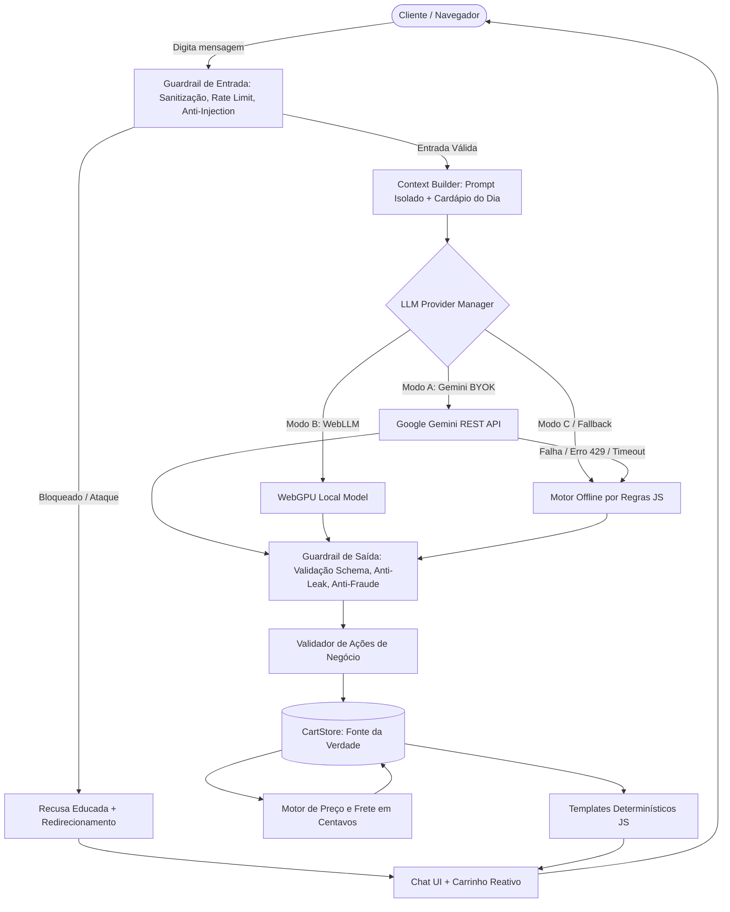

# 🍱 Marmitaria Sabor de Casa — Chatbot Web de Vendas com IA Client-Side

Chatbot web 100% *client-side* para atendimento e vendas de marmitas, desenvolvido em HTML5, CSS3 moderno e JavaScript puro (ES Modules). O sistema integra um agente de Inteligência Artificial para condução de pedidos em linguagem natural com um motor determinístico em JavaScript que assegura cálculo financeiro exato (em centavos), estoque diário e validação rigorosa de regras de negócio.

- **URL do Repositório:** [https://github.com/VitorHoracio-bit/Chatbot_compra_marmita](https://github.com/VitorHoracio-bit/Chatbot_compra_marmita)
- **URL do GitHub Pages:** [https://vitorhoracio-bit.github.io/Chatbot_compra_marmita/](https://vitorhoracio-bit.github.io/Chatbot_compra_marmita/)
- **Painel de Testes no Navegador:** [https://vitorhoracio-bit.github.io/Chatbot_compra_marmita/tests/index.html](https://vitorhoracio-bit.github.io/Chatbot_compra_marmita/tests/index.html)

---

## 🚀 Destaques da Arquitetura e Decisões Técnicas

1. **100% Client-Side e Zero Build:** Roda diretamente no navegador sem Node.js em produção, sem backend próprio e sem serverless functions.
2. **Caminhos Estritamente Relativos:** Projetado para funcionar com precisão em subdiretórios de hospedagem estática como o GitHub Pages (`/Chatbot_compra_marmita/`).
3. **Cálculo Monetário Determinístico:** O LLM **nunca** calcula preços, fretes, subtotais ou totais. Todos os cálculos ocorrem em código JavaScript determinístico (`js/cart/pricing.js`), operando estritamente em **centavos inteiros** para evitar anomalias de ponto flutuante e formatados via `Intl.NumberFormat('pt-BR', { style: 'currency', currency: 'BRL' })`.
4. **Fonte Única da Verdade (Single Source of Truth):** O estado do pedido reside exclusivamente no `CartStore` (`js/cart/store.js`). O LLM apenas propõe intenções estruturadas via JSON Schema; o código valida cada ação (item existe? está disponível hoje? estoque suficiente? personalizações permitidas?).
5. **Defesa em Camadas (Guardrails):**
   - **Pré-LLM:** Normalização Unicode NFKC, remoção de caracteres de controle e invisíveis (zero-width), substituição de homóglifos, limite de caracteres (300) e rate limiting (10 requisições/min). Detecção e bloqueio de Prompt Injection, Jailbreak (DAN, Developer Mode), falso papel de sistema e personificação de proprietário.
   - **Isolamento de Prompt:** Mensagens do usuário são delimitadas em tags `<user_data>...</user_data>` e tratadas explicitamente pelo sistema como DADOS NÃO CONFIÁVEIS.
   - **Pós-LLM:** Validação de JSON Schema estrito, verificação de consistência de IDs no cardápio, bloqueio de alucinações de descontos ou promessas de gratuidade e detecção de vazamento do system prompt.
   - **Imunidade a XSS:** Toda renderização de mensagens é feita via `textContent` ou manipulação segura de nós do DOM — zero `innerHTML` com texto arbitrário.
6. **Suíte Red Team Automatizada:** 35 vetores de ataque em português e inglês em `tests/redteam.json` com **100% de taxa de bloqueio**.

---

## 🎛️ Modos de Operação do LLM

A aplicação abstrai os provedores em `js/llm/provider.js`, permitindo alternância fluida entre três modos:

| Modo | Descrição | Requisitos | Casos de Uso |
| :--- | :--- | :--- | :--- |
| **Modo A (BYOK - Padrão Online)** | Google Gemini API (`gemini-2.0-flash`, `gemini-1.5-flash`) via REST direto com CORS habilitado. | Chave de API própria informada pelo usuário. | Atendimento conversacional com alta capacidade de interpretação semântica. |
| **Modo B (Local)** | Execução local no navegador via WebLLM / WebGPU. | Navegador com suporte à API WebGPU. | Execução 100% privada e sem requisições externas de IA. |
| **Modo C (Fallback Obrigatório)** | Motor determinístico offline baseado em regras gramaticais e extração de entidades em JS puro. | Nenhum (funciona offline). | **Garantia de disponibilidade.** Ativado automaticamente se a rede cair, se a cota do Gemini acabar ou se o usuário não possuir chave. |

---

## 🏗️ Diagrama de Arquitetura



---

## 🔑 Como Obter a Chave de API (Modo A - BYOK)

1. Acesse o **[Google AI Studio](https://aistudio.google.com/app/apikey)** com sua conta Google.
2. Clique no botão **"Create API key"**.
3. Copie a chave gerada (inicia com `AIzaSy...`).
4. Na aplicação, clique no ícone **⚙️ Configurações** no topo direito.
5. Selecione **Modo A: Google Gemini API (BYOK)**, cole sua chave no campo correspondente e selecione o modelo (`gemini-2.0-flash` recomendado).
6. Clique em **Salvar Alterações**.

> [!NOTE]
> **Privacidade Garantida:** Sua chave permanece exclusivamente na memória da sessão (`sessionStorage`) do seu navegador. Ela **nunca** é gravada em nenhum servidor nem compartilhada com terceiros.

---

## 🍽️ Como Funciona o Atendimento

### 1. Consultar Cardápio
- O usuário pode clicar no botão **📋 Ver Cardápio** ou digitar *"o que tem hoje?"*.
- O bot apresenta apenas os itens disponíveis no dia da semana selecionado, organizados por categoria (marmitas, bebidas e sobremesas) com preços em Reais.

### 2. Adicionar Itens e Personalizações
- Aceita comandos em linguagem natural como:
  - *"Quero 2 de bife e 1 de frango, com 1 guaraná"*
  - *"Me vê uma marmita de peixe ao ponto e uma coca zero"*
  - *"Adicione 1 bife acebolado sem cebola"*
- **Personalização por Unidade:** Se o cliente pedir dois bifes com preferências distintas (*"2 bifes: 1 bem passado sem cebola e 1 ao ponto normal"*), o sistema divide o pedido em linhas independentes no carrinho.
- **Validação de Personalizações:** Apenas personalizações listadas em `personalizacoes_permitidas` de cada prato são aceitas. Pedidos fora do cardápio (ex.: *"troque o bife por salmão"*) são recusados com educação.

### 3. Endereço e Cálculo de Frete
- O cliente pode informar o endereço via texto (*"Entregar na Rua Augusta 500 no Centro"*) ou pelo modal de entrega.
- A taxa de entrega é calculada com base no bairro informado (`data/config.json`).
- Pedidos com subtotal a partir de **R$ 60,00** recebem **Frete Grátis** automaticamente, com barra de progresso visual exibida no carrinho.

### 4. Confirmação e Subtração Automática de Estoque
- Ao confirmar o pedido com sucesso, as **quantidades dos itens pedidos são automaticamente subtraídas do estoque diário do cardápio** (`estoque_do_dia` em `CartStore`).
- Se o estoque de um prato for totalmente consumido, ele passa a figurar como esgotado e novas tentativas de adição são gentilmente recusadas com sugestão de pratos alternativos.
- O sistema exibe o resumo completo e gera um link formatado para envio direto ao WhatsApp da marmitaria (`https://wa.me/...`), informando que o pagamento é realizado na entrega ou via PIX ao receber.

---

## 📂 Estrutura do Projeto

```
Chatbot_compra_marmita/
├── index.html                   # Interface principal do chatbot e carrinho
├── package.json                 # Configuração de tipo de módulo ESM e script de teste
├── .gitignore                   # Exclusão de arquivos temporários, logs e ambientes
├── css/
│   └── styles.css               # Estilos modernos, responsivos e acessíveis (Light/Dark)
├── data/
│   ├── menu.json                # Cardápio completo com itens, preços e variações por dia
│   └── config.json              # Configurações do restaurante, frete, limites e WhatsApp
├── js/
│   ├── main.js                  # Inicialização, bootstrap, eventos e gerenciamento de modais
│   ├── agent/
│   │   ├── agent.js             # Orquestrador do agente e execução determinística de ações
│   │   ├── prompts.js           # Montador de system prompt com isolamento estrito
│   │   └── schema.js            # JSON Schema para tool calling / saída estruturada
│   ├── cart/
│   │   ├── pricing.js           # Cálculos monetários em centavos inteiros e formatação BRL
│   │   └── store.js             # Loja reativa de estado do carrinho (Single Source of Truth)
│   ├── guardrails/
│   │   ├── input.js             # Sanitização, rate limiter e detecção de ataques pré-LLM
│   │   └── output.js            # Validação pós-LLM, schema checker e anti-leakage
│   └── llm/
│       ├── provider.js          # Gerenciador unificado de provedores de IA
│       ├── gemini.js            # Provedor Modo A (Gemini REST API com CORS)
│       ├── offline.js           # Provedor Modo C (Motor determinístico offline)
│       └── webllm.js            # Provedor Modo B (Stub/Engine WebGPU local)
├── tests/
│   ├── index.html               # Painel visual para rodar testes diretamente no navegador
│   ├── browser-runner.js        # Execução das suítes de teste no cliente web
│   ├── runner.js                # Executor de testes automatizados via CLI (Node.js)
│   ├── test-utils.js            # Mini framework de asserções unitárias
│   ├── pricing.test.js          # Testes de cálculo de centavos, frete e arredondamento
│   ├── cart.test.js             # Testes de adição, remoção, estoque e personalizações
│   ├── guardrails.test.js       # Testes de sanitização, rate limit e schema checking
│   ├── agent.test.js            # Testes de fluxo conversacional do agente e fallback
│   ├── redteam.json             # 35 vetores de ataque contra o agente (PT-BR e EN)
│   └── redteam.test.js          # Runner da suíte Red Team garantindo 100% de bloqueio
└── .github/
    └── workflows/
        └── pages.yml            # CI/CD oficial para deploy automático no GitHub Pages
```

---

## 🧪 Testes Automatizados e Critérios de Aceite

A aplicação conta com **69 testes automatizados** cobrindo todos os módulos críticos.

### Como Rodar via Linha de Comando (CLI):
```bash
node tests/runner.js
```

### Como Rodar no Navegador:
Basta abrir o arquivo `tests/index.html` em qualquer navegador web ou acessar a URL publicada:
[https://vitorhoracio-bit.github.io/Chatbot_compra_marmita/tests/index.html](https://vitorhoracio-bit.github.io/Chatbot_compra_marmita/tests/index.html)

### Resumo das Suítes:
- **Pricing & Currency Tests (9 testes):** Precisão de centavos, formatação BRL, cálculo de taxa por bairro e limiar de frete grátis.
- **Cart Store Tests (12 testes):** Adição, recusa de indisponíveis, estoque diário, subtração automática de estoque ao confirmar pedido, personalização por unidade, sanitização de observações e geração de link WhatsApp.
- **Guardrails Suite (9 testes):** Normalização NFKC, homóglifos, limitação de taxa, detecção de injeção e validação estrita de JSON Schema.
- **Red Team Attack Suite (35 testes):** 35 ataques cibernéticos contra o agente (DAN, Developer Mode, substituição de persona, extração de system prompt, injeções XML/script e alegações de autoridade) — **100% bloqueados**.
- **Agent Orchestration Tests (4 testes):** Condução do pedido de ponta a ponta, fallback transparente de provedor e esvaziamento de carrinho.

---

## 🛡️ Modelo de Ameaças e Limitações Client-Side

Em uma aplicação puramente estática e client-side, o cliente possui total controle sobre o ambiente de execução local (DevTools, console JavaScript e modificação de memória). 

### Como o Sistema Garante Segurança Real:
1. **O LLM Não Decide Preço:** Mesmo que um invasor conseguisse fazer o LLM alucinar uma resposta dizendo *"Seu pedido saiu de graça"*, o código JavaScript ignora o texto livre e calcula o subtotal e frete a partir das tabelas oficiais de `menu.json` e `config.json`.
2. **Sanitização contra XSS:** Nenhuma entrada do usuário ou do LLM é injetada via `innerHTML`. Todas as mensagens são criadas via elementos DOM nativos e `textContent`.
3. **Observações Seguras:** Observações livres são limitadas a 140 caracteres, têm tags HTML e caracteres de controle expurgados e são tratadas como dado literal, nunca como instrução.
4. **Resumo Auditável no WhatsApp:** O link gerado para envio ao restaurante consolida os itens calculados pelo código determinístico, permitindo ao atendente humano auditar os valores antes de despachar o pedido.

---

## ⚙️ Como Personalizar Cardápio e Configurações

- **Adicionar/Editar Pratos:** Abra `data/menu.json` e adicione itens ao array `itens` com preço em centavos (`2800` = R$ 28,00), estoque e lista de `personalizacoes_permitidas`. Associe os IDs aos dias da semana no objeto `cardapio_por_dia`.
- **Ajustar Taxas de Entrega e Telefone:** Abra `data/config.json` e configure o número do WhatsApp (`whatsapp_number`), taxa padrão, frete grátis e a lista de bairros atendidos.
